# Gestión de medicamentos en la farmacia de un hospital

**Diseño de la arquitectura de una aplicación empresarial con ArchiMate y DDD** · Tema 3 · Arquitectura de Software

Modelo fuente: [`modelo/proyecto.archimate`](modelo/proyecto.archimate) (un único modelo con 20 vistas) · Imágenes: [`/vistas`](vistas) · Entrevista: [`/entrevista`](entrevista)

---

## Índice

1. [Contexto y entrevista](#s1)
2. [Motivación](#s2)
   - [V1 - Motivación](#v1)
3. [Mapa de capacidades y proceso E2E](#s3)
   - [V2 - Mapa de capacidades](#v2)
   - [V3 - Cadena de valor y proceso E2E](#v3)
4. [Descomposición de servicios](#s4)
   - [V4 - Descomposición de servicios](#v4)
   - [V4.5 - Del proceso E2E a los servicios](#v4-5)
   - [Tabla de inclusión y exclusión](#tabla-inclusion)
   - [V4.3 - Funciones, roles y trazabilidad](#v4-3)
   - [V4.4 - Objetos de negocio de los servicios](#v4-4)
   - [V4.2 - Capa anticorrupción de negocio](#v4-2)
   - [V4.1 - Contratos de servicio (Contract First)](#v4-1)
5. [Dominios y lenguaje ubicuo](#s5)
   - [V5 - Dominios](#v5)
   - [V7 - Lenguaje ubicuo](#v7)
   - [V7.1 - Términos con varios significados](#v7-1)
6. [Agregados, comandos y eventos](#s6)
   - [V6.1 - Agregado Lote](#v6-1)
   - [V6.2 - Agregados de vencimientos](#v6-2)
   - [V6.3 - Planeación de la demanda](#v6-3)
   - [V6.4 - Catálogo de medicamentos](#v6-4)
7. [Mapa de contextos e interoperabilidad](#s7)
   - [V8 - Mapa de contextos](#v8)
   - [V9 - Interoperabilidad y anticorrupción](#v9)
   - [V10 - Trazabilidad vertical](#v10)
8. [Bounded Context Canvas](#s8)
   - [V11 - Bounded Context Canvas](#v11)
9. [Decisiones y supuestos](#s9)
10. [Tabla de aportes](#s10)

---

## 1. Contexto y entrevista

**La solicitud.** La farmacia del hospital atiende demanda programada (cirugías, procedimientos, hospitalización) y no programada (urgencias), y necesita un software que apoye la gestión de medicamentos y reduzca las pérdidas por vencimiento. El alcance del enunciado son cuatro puntos: inventario por lote y vencimiento, alertas de próximos a vencer, predicción de la demanda y requerimientos de compra.

**La entrevista.** Configuramos una IA como *director del servicio farmacéutico* y la entrevistamos con un guion por temas: contexto, proceso E2E, actores, reglas, excepciones, indicadores, normatividad y un **bloque específico de interoperabilidad**. Respetamos la regla del enunciado: a la IA no se le pidió ningún producto de diseño (capacidades, dominios, agregados, mapa de contextos ni vistas).

| Evidencia | Archivo |
|---|---|
| Instrucción de rol | [`entrevista/instruccion_rol.md`](entrevista/instruccion_rol.md) |
| Guion | [`entrevista/guion.md`](entrevista/guion.md) |
| Conversación completa | [`entrevista/entrevista_experto_negocio.md`](entrevista/entrevista_experto_negocio.md) |
| Análisis de hallazgos | [`entrevista/analisis_hallazgos.md`](entrevista/analisis_hallazgos.md) |

**Lo esencial que encontramos** (análisis §1):

- El hospital pierde **unos $310 millones al año** por vencidos (1,1 % de lo que compra) y, a la vez, tiene agotados y compras urgentes.
- **La causa raíz:** cuando un medicamento sale, no se registra de qué lote salió. Nadie sabe con certeza qué lote hay, dónde está ni cuándo vence.
- **Por qué se vence:** se compra con promedios (40 %), hay producto quieto en los servicios (25 %), llega con poca vida útil (20 %) y cambian los protocolos (15 %).
- **Condiciones:** el sistema recomienda y una persona decide; no hay personal nuevo; **los sistemas hospitalario y contable no se pueden modificar**.

**Cómo procesamos los hallazgos.** Cada uno quedó **aceptado** (§2), **aceptado pero simplificado** (§3) o **descartado** (§4), con su razón y la vista donde influyó. El criterio fue quedarnos con lo que apoya los cuatro puntos del alcance. Las simplificaciones más importantes:

| Lo que dijo el experto | Cómo lo tratamos | Por qué |
|---|---|---|
| Farmacia central, satélites, stocks de piso y carros de paro | **Una sola farmacia con varias ubicaciones** | El lote se controla por ubicación; modelar cada punto aparte no cambia la meta |
| Alertas según la rotación de cada medicamento | **Alertas fijas a 6, 3 y 1 mes** | Ya las usa el hospital; la de 6 meses la exige el proveedor para aceptar el canje |
| Predicción con estacionalidad, censo de camas, anestesia y cirujano | **Agenda × paquetes** (programada) y **promedio del histórico** (no programada) | Cumple el enunciado ("programación y análisis histórico") sin modelos complejos |
| Varios niveles de aprobación | **Una sola regla**: el químico aprueba y quien elabora no aprueba | Simplicidad sin perder control |
| La dispensación ya está en el sistema hospitalario, sin lote | **La dispensación sigue allí**; nuestro software recibe cada salida y la descuenta del lote correcto | No se puede modificar ese sistema |
| Ante un retiro del INVIMA: ubicar, rastrear pacientes, devolver, responder | **Solo retener el lote** en todas sus ubicaciones | El resto lo hace farmacovigilancia |

Descartamos, entre otros, el control especial, la cadena de frío, los residuos, la farmacovigilancia, el SISMED, la facturación y el censo de camas (§4). Verificamos en fuentes oficiales las normas que usamos (§6): la Resolución 1403 de 2007 respalda el FEFO, y la Resolución 1732 de 2026 que citó el experto fue revocada, así que la habilitación sigue en la Resolución 3100 de 2019.

---

## 2. Motivación

### V1 - Motivación

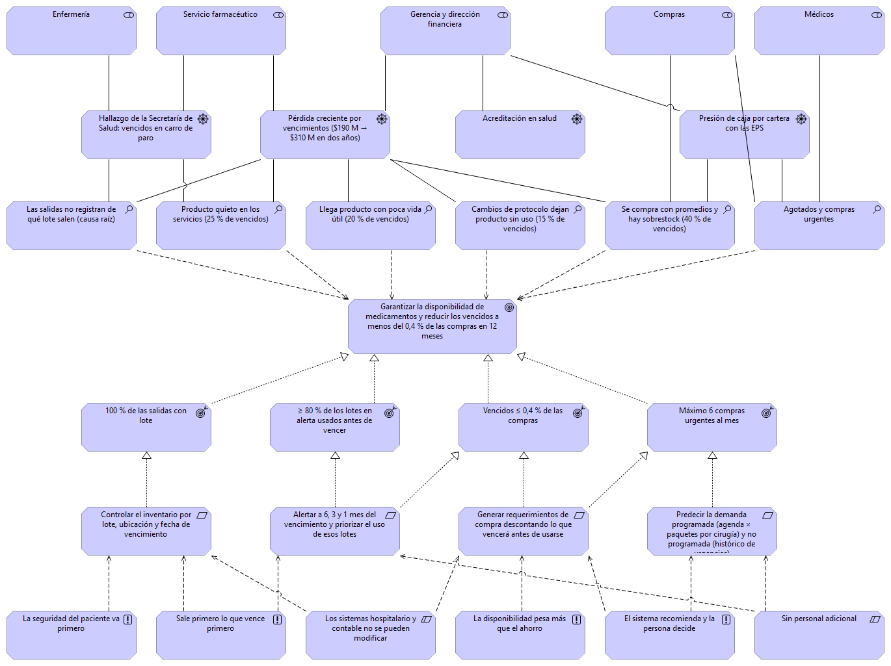

**Qué muestra.** Por qué existe la aplicación, solo con elementos de motivación:

- **Interesados:** Servicio farmacéutico, Gerencia y dirección financiera, Médicos, Enfermería y Compras.
- **Impulsores:** la pérdida creciente ($190 M → $310 M), el hallazgo de la Secretaría de Salud (vencidos en un carro de paro), la presión de caja por la cartera con las EPS y la acreditación.
- **Evaluaciones:** la **causa raíz** y las causas de los vencidos con su peso.
- **Meta:** garantizar la disponibilidad y reducir los vencidos a menos del 0,4 % de las compras en 12 meses.
- **Resultados medibles:** vencidos ≤ 0,4 %, 100 % de las salidas con lote, ≥ 80 % de lo alertado usado antes de vencer y máximo 6 compras urgentes al mes.
- **Requerimientos R1–R4:** inventario por lote, alertas, predicción y requerimiento de compra.
- **Principios** y **restricciones**.

**Cómo se lee.** Interesados → impulsores → evaluaciones → **meta** ← resultados ← requerimientos ← principios y restricciones.

**Argumentación de las decisiones:**

| Decisión | Por qué |
|---|---|
| Separar la **causa raíz** de las demás causas | Todo el diseño gira alrededor de ella: el servicio S13, el agregado Lote y el dominio central |
| Resultados **con número** | La meta tiene que ser verificable; más adelante el servicio S20 calcula estos indicadores |
| R1–R4 = los 4 puntos del alcance | Mantiene una correspondencia uno a uno con las capacidades (V2) y las funciones (V4.3) |
| **Influencia** de evaluaciones a la meta y de principios y restricciones a los requerimientos | Un problema o una regla **afectan** a otro elemento; no lo "hacen realidad" |
| **Realización** requerimiento → resultado → meta | Cumplir el requerimiento produce el resultado, que concreta la meta |
| 5 interesados principales | Para no recargar la vista (análisis §2) |

La restricción *los sistemas hospitalario y contable no se pueden modificar* es la que justifica la capa anticorrupción de la Fase 2. El principio *el sistema recomienda y la persona decide* explica por qué la predicción y el requerimiento terminan en una aprobación humana.

---

## 3. Mapa de capacidades y proceso E2E

### V2 - Mapa de capacidades

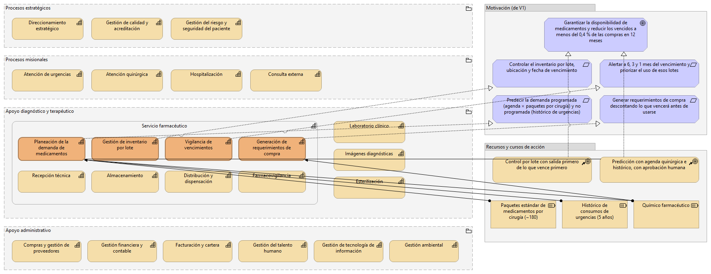

**Qué muestra.**
- **25 capacidades** del hospital organizadas en los 4 macroprocesos (agrupaciones): estratégicos, misionales, apoyo diagnóstico y terapéutico, y apoyo administrativo.
- Dentro de *Servicio farmacéutico* están sus 8 subcapacidades. **Las 4 impactadas** (propiedad `impactada = sí`, en naranja) realizan cada una un requerimiento: *Planeación de la demanda* → R3, *Gestión de inventario por lote* → R1, *Vigilancia de vencimientos* → R2, *Generación de requerimientos de compra* → R4.
- **Recursos:** paquetes por cirugía, histórico de urgencias y químico farmacéutico.
- **Cursos de acción:** control por lote con FEFO; predicción con agenda e histórico y aprobación humana.

**Argumentación:**

| Decisión | Por qué |
|---|---|
| **Mapa completo** del hospital, no solo la farmacia | Ubica la aplicación en el negocio; un mapa centrado solo en la aplicación sería parcial |
| Macroprocesos como **agrupaciones** del modelo | Son el mapa de procesos que describió el experto; como elementos del modelo se pueden relacionar (agregan sus capacidades) |
| Capacidad ★ → **realiza** → requerimiento | Es el puente vertical estrategia → motivación sobre el que se apoya la trazabilidad (V10) |
| Recurso → **asignación** → capacidad | Relación estándar para indicar qué recurso usa cada capacidad |
| *Químico farmacéutico* como **recurso** (aquí) y como **rol** (V3) | Son conceptos distintos: un activo que necesita la capacidad y un papel que ejecuta procesos |
| Cursos de acción **asociados** a las capacidades | Al modelar no confirmamos que la realización fuera válida; la asociación deja el vínculo sin afirmar más |

### V3 - Cadena de valor y proceso E2E

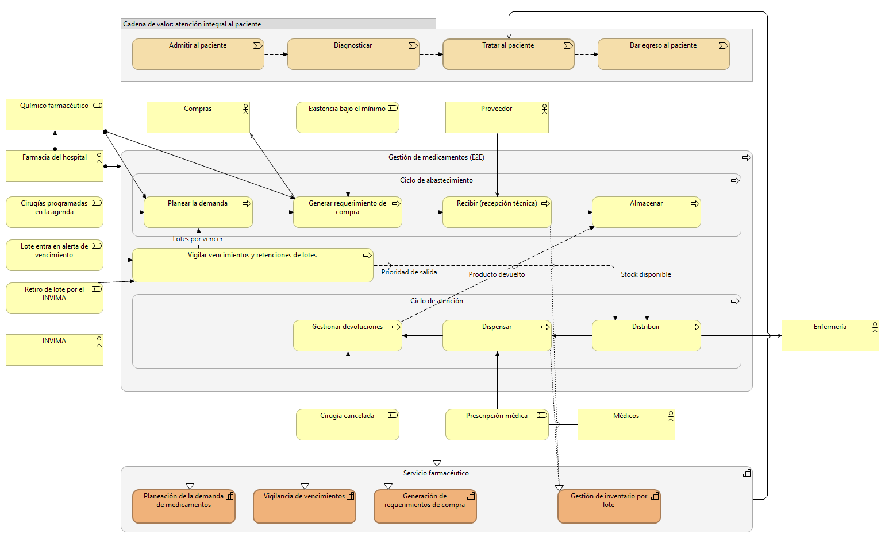

**Qué muestra.**
- **Arriba**, el flujo de valor del hospital: *Admitir → Diagnosticar → Tratar al paciente → Dar egreso*. La capacidad *Servicio farmacéutico* **sirve a** *Tratar al paciente*.
- **En el centro**, el proceso **Gestión de medicamentos (E2E)**, compuesto por:
  - el **ciclo de abastecimiento:** Planear la demanda → Generar requerimiento → Recibir (recepción técnica) → Almacenar;
  - el **ciclo de atención:** Distribuir → Dispensar → Gestionar devoluciones;
  - y, **en paralelo**, *Vigilar vencimientos y retenciones de lotes*.
- **Alrededor**, los **6 eventos** que disparan el proceso: cirugías programadas, existencia bajo el mínimo, prescripción médica, lote en alerta, retiro del INVIMA y cirugía cancelada.
- **Los actores:** Farmacia del hospital desempeña el rol Químico farmacéutico; *Generar requerimiento* sirve a Compras, *Distribuir* sirve a Enfermería y el Proveedor sirve a *Recibir*.
- **Abajo**, cada proceso **realiza** su capacidad ★.

**Argumentación:**

| Decisión | Por qué |
|---|---|
| Dos ciclos y la vigilancia en paralelo | Así lo describió el experto (análisis §2); la vigilancia afecta tanto a la compra como a la distribución |
| **Disparo** entre actividades y **flujo** desde la vigilancia | El disparo es secuencia; el flujo es información ("lotes por vencer", "prioridad de salida"). La vigilancia informa, no inicia |
| *Almacenar → Distribuir* con **flujo** ("stock disponible") | Distribuir no ocurre cada vez que se almacena, sino cuando un servicio lo necesita |
| Comprar y administrar **fuera** del proceso | Farmacia dice qué y cuánto, compras dice a quién y a qué precio; administrar lo hacen enfermería y anestesia |
| Procesos que **realizan** capacidades | Une el *cómo* (negocio) con el *qué* (estrategia) |

---

## 4. Descomposición de servicios

### V4 - Descomposición de servicios

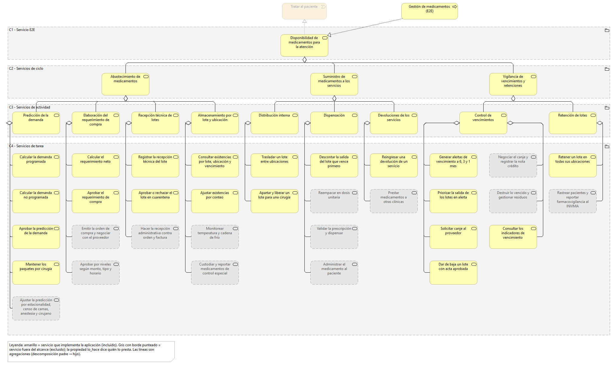

**Qué muestra.** El proceso E2E descompuesto en **4 capas de servicios de negocio**, cada una modelada como **agrupación** (con la propiedad `capa_soa`). Los servicios se unen en árbol por **agregación**:

| Capa | Contenido | Equivalencia SOA |
|---|---|---|
| C1 - Servicio E2E | 1: *Disponibilidad de medicamentos para la atención* | Proceso de negocio |
| C2 - Servicios de ciclo | 3: abastecimiento, suministro a los servicios, vigilancia | Subproceso / orquestación |
| C3 - Servicios de actividad | 9: uno por proceso de la V3 (la vigilancia se parte en *Control de vencimientos* y *Retención de lotes*) | Servicio de negocio |
| C4 - Servicios de tarea | 33: **20 que se implementan (S01–S20, amarillo)** y **13 que no (X01–X13, gris punteado)** | Tarea |
| C5 - Capa anticorrupción | A1–A7 y E1–E7 (en la [V4.2](#v4-2)) | Utilitario / integración |

**Argumentación:**

| Decisión | Por qué | Alternativa descartada |
|---|---|---|
| **4 capas** de descomposición + C5 de integración | El enunciado pide mínimo cuatro; bajamos del E2E a ciclos, actividades y tareas | Menos capas: no se llegaría al tamaño adecuado |
| El **tamaño adecuado** es la tarea (C4): algo que una persona hace en una sentada | Es el nivel en que se puede decidir con precisión qué construye el software | Decidir a nivel de actividad: mezclaría lo que se construye con lo que no |
| Capas como **agrupación** del modelo | El enunciado pide "agrupación" en la V4; así la capa existe en el modelo y se puede trazar | Recuadros visuales, que no existen en el modelo |
| **Agregación** padre → hijo | El hijo tiene sentido propio y puede usarse en otro contexto | Composición, que diría que el hijo no existe sin el padre |
| C1 **realiza** *Tratar al paciente* | ArchiMate no permite que un servicio de negocio *sirva a* un flujo de valor (el validador lo rechazó). La realización es parcial: la farmacia aporta a esa etapa, no la hace sola | Asociación, que no aporta a la trazabilidad |
| Nombres que no repiten los de capacidades o procesos | Evita confundir, por ejemplo, el servicio *Recepción técnica de lotes* con la capacidad *Recepción técnica* | — |
| **Excluidos visibles** en gris | La justificación de lo que **no** se construye es la mitad de la tabla de inclusión y exclusión | Ocultarlos |

### V4.5 - Del proceso E2E a los servicios

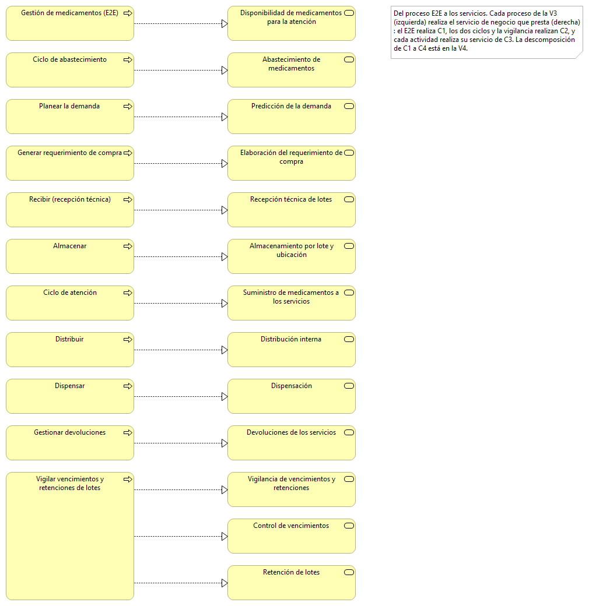

**Qué muestra.** Las 13 **realizaciones** proceso → servicio que anclan la descomposición al proceso levantado en la entrevista:
- el E2E realiza C1;
- cada ciclo realiza su servicio de C2;
- cada actividad realiza su servicio de C3;
- *Vigilar vencimientos y retenciones* realiza C2.3, C3.8 y C3.9.

**Argumentación.** En la V4 solo se dibujó la realización del E2E para no meter los 11 procesos. Esta vista muestra las demás y prueba que **ningún servicio es inventado**: cada uno es lo que un proceso real ofrece hacia fuera.

### Tabla de inclusión y exclusión

**Criterio.** Un servicio de tarea **se implementa** si realiza uno de R1–R4 o protege una regla que la meta necesita. **No se implementa** si el análisis lo simplificó (§3) o lo descartó (§4), o si lo hace otra área o un sistema que no se puede modificar (§1, §5). La justificación de cada uno está también en su documentación dentro del modelo.

**Servicios que se implementan (20)**

| Código | Servicio | Bajo (C3) | Ejecuta | Realiza | Justificación |
|---|---|---|---|---|---|
| **S01** | Calcular la demanda programada | C3.1 Predicción de la demanda | Automático; revisa el químico farmacéutico | R3 | Agenda quirúrgica × paquetes por cirugía. |
| **S02** | Calcular la demanda no programada | C3.1 Predicción de la demanda | Automático; revisa el químico farmacéutico | R3 | Promedio del histórico de 5 años de consumos de urgencias. |
| **S03** | Aprobar la predicción de la demanda | C3.1 Predicción de la demanda | Químico farmacéutico | R3 | El sistema recomienda y la persona decide; quien elabora no aprueba. |
| **S04** | Mantener los paquetes por cirugía | C3.1 Predicción de la demanda | Químico farmacéutico | R3 | Insumo de S01; se cargan una vez desde el Excel actual y los mantiene farmacia. |
| **S05** | Calcular el requerimiento neto | C3.2 Elaboración del requerimiento de compra | Automático; revisa el químico farmacéutico | R4 | Consumo × tiempo a cubrir − existencias − lo que viene en camino − lo que vencerá antes de usarse; frena la compra de lo que está en alerta. |
| **S06** | Aprobar el requerimiento de compra | C3.2 Elaboración del requerimiento de compra | Químico farmacéutico | R4 | Única regla de aprobación: quien elabora no aprueba. |
| **S07** | Registrar la recepción técnica del lote | C3.3 Recepción técnica de lotes | Regente de farmacia | R1 | El lote y el vencimiento se registran al recibir, aunque el código de barras no los traiga; el lote entra en cuarentena. |
| **S08** | Aprobar o rechazar el lote en cuarentena | C3.3 Recepción técnica de lotes | Regente de farmacia distinto del que registró | R1 | Nada sale sin recepción técnica. |
| **S09** | Consultar existencias por lote, ubicación y vencimiento | C3.4 Almacenamiento por lote y ubicación | Químico farmacéutico y regente de farmacia | R1 | Es lo que más pide el experto: qué lote hay, cuánto, dónde y con qué vencimiento. |
| **S10** | Trasladar un lote entre ubicaciones | C3.5 Distribución interna | Regente de farmacia; quien recibe confirma | R1, R2 | Una farmacia con varias ubicaciones; trasladar es una acción ante la alerta. |
| **S11** | Ajustar existencias por conteo | C3.4 Almacenamiento por lote y ubicación | Regente propone, químico aprueba | R1 | Decisión del equipo: hace falta para que el lote cuadre con el conteo físico. |
| **S12** | Apartar y liberar un lote para una cirugía | C3.5 Distribución interna | Regente de farmacia | R2 | Acción ante la alerta; se libera si la cirugía se cancela. |
| **S13** | Descontar la salida del lote que vence primero | C3.6 Dispensación | Automático | R1 | La dispensación sigue en el sistema hospitalario; aquí se recibe la salida y se descuenta del lote correcto. Logra el 100 % de salidas con lote. |
| **S14** | Reingresar una devolución de un servicio | C3.7 Devoluciones de los servicios | Regente de farmacia | R1 | Devolución de un servicio del hospital, distinta de la devolución al proveedor. |
| **S15** | Generar alertas de vencimiento a 6, 3 y 1 mes | C3.8 Control de vencimientos | Automático | R2 | Alertas fijas. La alerta no cambia el estado: el lote sigue disponible con prioridad. El día que llega su fecha de vencimiento, el lote pasa a vencido. |
| **S16** | Priorizar la salida de los lotes en alerta | C3.8 Control de vencimientos | Químico farmacéutico | R2 | Sale primero lo que vence primero; próximo a vencer es una alerta, no un estado. |
| **S17** | Retener un lote en todas sus ubicaciones | C3.9 Retención de lotes | Regente retiene, químico confirma | R1 | Ante un retiro del INVIMA solo se retiene el lote. |
| **S18** | Solicitar canje al proveedor | C3.8 Control de vencimientos | Químico farmacéutico | R2 | Solo la solicitud; la alerta de 6 meses existe porque el proveedor la pide para aceptar el canje. |
| **S19** | Dar de baja un lote con acta aprobada | C3.8 Control de vencimientos | Regente elabora el acta, químico aprueba | R1 | Baja con acta aprobada; alimenta a contabilidad. |
| **S20** | Consultar los indicadores de vencimiento | C3.8 Control de vencimientos | Automático; lo consultan el químico farmacéutico y la gerencia | Resultados de la V1 (medición) | Calcula los indicadores que solo esta aplicación puede medir, porque es la única que conoce el lote: % de salidas con lote, % de lo alertado usado antes de vencer y valor dado de baja por vencimiento. El % de vencidos sobre compras lo completa financiera con el valor de compras, y las compras urgentes las reporta compras. Antes estaba excluido (X14); se incluyó para medir los resultados de la V1 (decisión del equipo). |

**Servicios que no se implementan (13)**

| Código | Servicio | Bajo (C3) | Quién lo hace | Justificación |
|---|---|---|---|---|
| **X01** | Ajustar la predicción por estacionalidad, censo de camas, anestesia y cirujano | C3.1 Predicción de la demanda | Nadie (mejora futura) | Simplificado: lo programado sale de los paquetes y lo no programado del histórico; censo de camas descartado. |
| **X02** | Emitir la orden de compra y negociar con el proveedor | C3.2 Elaboración del requerimiento de compra | Compras | Farmacia dice qué y cuánto; compras dice a quién y a qué precio. |
| **X03** | Aprobar por niveles según monto, tipo y horario | C3.2 Elaboración del requerimiento de compra | No se adopta | Una sola regla de aprobación: quien elabora no aprueba. |
| **X04** | Hacer la recepción administrativa contra orden y factura | C3.3 Recepción técnica de lotes | Almacén / compras | La hace almacén o compras. |
| **X05** | Monitorear temperatura y cadena de frío | C3.4 Almacenamiento por lote y ubicación | Control de calidad del almacenamiento | Descartado; una falla de nevera solo entra como causa para retener (S17). |
| **X06** | Custodiar y reportar medicamentos de control especial | C3.4 Almacenamiento por lote y ubicación | Farmacia, con su propio registro | Proceso regulado con libro propio e informe al Fondo Rotatorio. |
| **X07** | Reempacar en dosis unitaria | C3.6 Dispensación | Farmacia (operación técnica) | No cambia el control por lote. |
| **X08** | Validar la prescripción y dispensar | C3.6 Dispensación | Sistema hospitalario | La dispensación sigue en el sistema hospitalario, que no se puede modificar. |
| **X09** | Administrar el medicamento al paciente | C3.6 Dispensación | Enfermería | Administrar no es dispensar. |
| **X10** | Prestar medicamentos a otras clínicas | C3.7 Devoluciones de los servicios | Farmacia (informal) | Informal y ocasional, sin impacto en la meta. |
| **X11** | Negociar el canje y registrar la nota crédito | C3.8 Control de vencimientos | Compras y contabilidad | Del canje solo se modela la solicitud. |
| **X12** | Destruir lo vencido y gestionar residuos | C3.8 Control de vencimientos | Gestión ambiental | Ocurre después de la baja. |
| **X13** | Rastrear pacientes y reportar farmacovigilancia al INVIMA | C3.9 Retención de lotes | Calidad (farmacovigilancia) | Ante un retiro solo se retiene el lote; el resto lo hace farmacovigilancia en su propio aplicativo. |

También quedan fuera, sin servicio dibujado: el reporte de precios al SISMED, la facturación y las glosas, la contingencia en papel, el identificador único de medicamentos (IUM) y las alertas dinámicas por rotación (análisis §3 y §4).

### V4.3 - Funciones, roles y trazabilidad

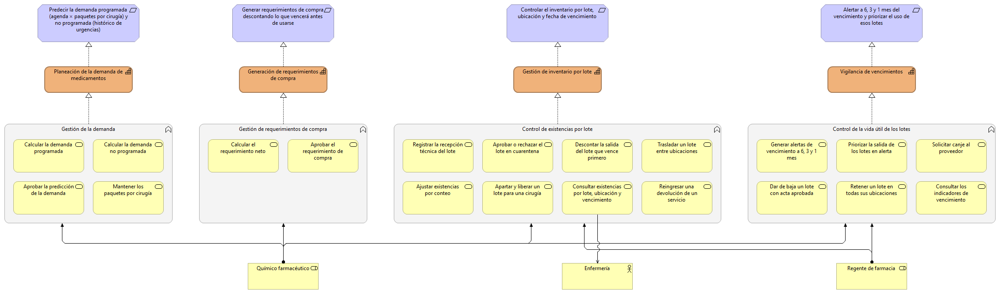

**Qué muestra.** Los 20 servicios incluidos dentro de las **4 funciones de negocio** que los realizan. Cada función **realiza** su capacidad ★, que realiza su requerimiento; los **roles** se asignan a las funciones que ejecutan.

| Función | Realiza la capacidad ★ | Servicios | Roles |
|---|---|---|---|
| F1 Gestión de la demanda | Planeación de la demanda de medicamentos | S01–S04 | Químico farmacéutico |
| F2 Gestión de requerimientos de compra | Generación de requerimientos de compra | S05, S06 | Químico farmacéutico |
| F3 Control de existencias por lote | Gestión de inventario por lote | S07–S14 | Regente de farmacia, químico farmacéutico |
| F4 Control de la vida útil de los lotes | Vigilancia de vencimientos | S15–S20 | Regente de farmacia, químico farmacéutico |

**Argumentación:**

| Decisión | Por qué |
|---|---|
| Rol **asignado a la función** | En ArchiMate la asignación significa "ejecuta"; quien **usa** un servicio se une con *sirve a* (por ejemplo, S09 sirve a Enfermería) |
| Rol nuevo **Regente de farmacia** | En la entrevista es quien opera el día a día (recibe, traslada, aparta, retiene, elabora actas); el químico aprueba. Permite modelar "quien registra no aprueba" |
| Servicios **anidados** en su función | El anidamiento expresa la realización y evita 20 líneas |
| Sin relación directa servicio → requerimiento | Se deduce de la cadena servicio ← función → capacidad → requerimiento; la propiedad `realiza` de cada servicio la deja escrita |

### V4.4 - Objetos de negocio de los servicios

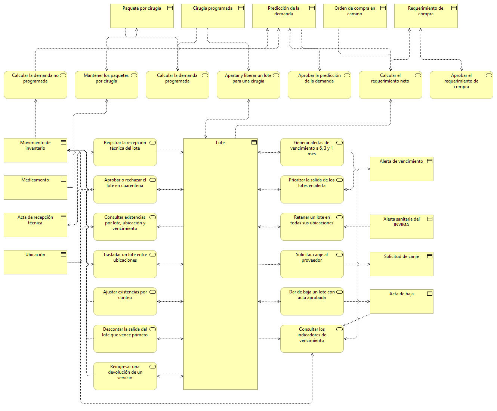

**Qué muestra.**
- Los **14 objetos de negocio** del lenguaje ubicuo y los **45 accesos** de lectura o escritura de los servicios de tarea.
- **Lote** está en el centro: lo leen o modifican **16 de los 20** servicios.

**Argumentación:**

| Decisión | Por qué |
|---|---|
| **Acceso** (no asociación), con su tipo | Muestra qué servicios **modifican** cada dato y cuáles solo lo consultan: S07 crea lotes, S20 solo lee |
| Nombres del lenguaje ubicuo | *Requerimiento de compra* ≠ *Orden de compra en camino*; *Alerta de vencimiento* no es un estado del lote |
| Crearlos en la Fase 2 | Son la semilla de los dominios (V5), el lenguaje (V7) y los agregados (V6) |

### V4.2 - Capa anticorrupción de negocio

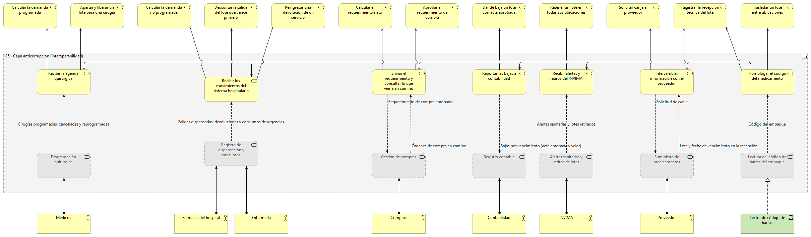

**Qué muestra.** La agrupación **C5 - Capa anticorrupción** con:
- los **servicios propios que traducen** (A1–A7);
- los **servicios externos** (E1–E7) y quién los presta;
- los **flujos** de información, con su nombre y la propiedad `direccion`;
- los servicios de tarea que consumen cada traducción.

**Por qué existe.** Los sistemas hospitalario y contable **no se pueden modificar** y **cada sistema identifica el medicamento con un código distinto** (análisis §1, §2). Nuestros servicios nunca hablan directamente con el exterior: lo hacen a través de un servicio propio que traduce, y todos usan el traductor común A7.

| Externo | Tipo | Lo presta | Información y dirección | Traduce | Lo usan |
|---|---|---|---|---|---|
| E1 Programación quirúrgica | Proceso interno | Médicos | ⬅ cirugías programadas, canceladas y reprogramadas | A1 | S01, S12 |
| E2 Registro de dispensación y consumos | Sistema legado | Farmacia del hospital y Enfermería | ⬅ salidas dispensadas, devoluciones y consumos de urgencias | A2 | S02, S13, S14 |
| E3 Gestión de compras | Proceso interno | Compras | ➡ requerimiento aprobado / ⬅ órdenes en camino | A3 | S05, S06 |
| E4 Suministro de medicamentos | Proveedor | Proveedor | ⬅ lote y vencimiento en la recepción / ➡ solicitud de canje | A4 | S07, S18 |
| E5 Registro contable | Sistema legado | Contabilidad | ➡ bajas por vencimiento (acta y valor) | A5 | S19 |
| E6 Alertas sanitarias y retiros | Ente regulador | INVIMA | ⬅ alertas sanitarias y lotes retirados | A6 | S17 |
| E7 Lectura del código de barras | Dispositivo | Lector de código de barras | ⬅ código del empaque | A7 | S07, S10 |

**A7 *Homologar el código del medicamento*** sirve a A1–A6: traduce cada código externo y el del empaque al código interno.

**Dónde quedó cada interoperabilidad del enunciado:**
- **Programación quirúrgica:** E1.
- **Historia clínica, prescripción y urgencias:** **dentro de E2**. La prescripción llega al sistema hospitalario, que dispensa; los consumos de urgencias se registran allí.
- **Compras y proveedores:** separados en E3 y E4.
- **Contabilidad:** E5.
- **Entes de vigilancia:** E6, solo el INVIMA.
- Además, la categoría **dispositivos** del enunciado: E7.

**Argumentación:**

| Decisión | Por qué |
|---|---|
| Un servicio propio de traducción por cada externo | Un cambio en un sistema externo solo afecta a su A, no a los servicios de tarea |
| **A7** como traductor común | La homologación la necesitan todos; se evita repetirla |
| **Flujo** entre E y A | Lo importante es **qué información** cruza y **hacia dónde** |
| **Sirve a** entre A y S | A le **presta** la información ya traducida al servicio que la usa |
| Las 5 categorías de externos del enunciado | Procesos internos (E1, E3), sistemas legados (E2, E5), proveedor (E4), ente regulador (E6) y dispositivo (E7) |
| E7 como **dispositivo** que realiza un servicio de tecnología | Un equipo no es un actor de negocio; es una deducción del supuesto 2 (código de barras del empaque) |
| A6 aunque el canal sea manual | El químico consulta la página del INVIMA; sigue siendo una traducción hacia nuestro modelo |

### V4.1 - Contratos de servicio (Contract First)

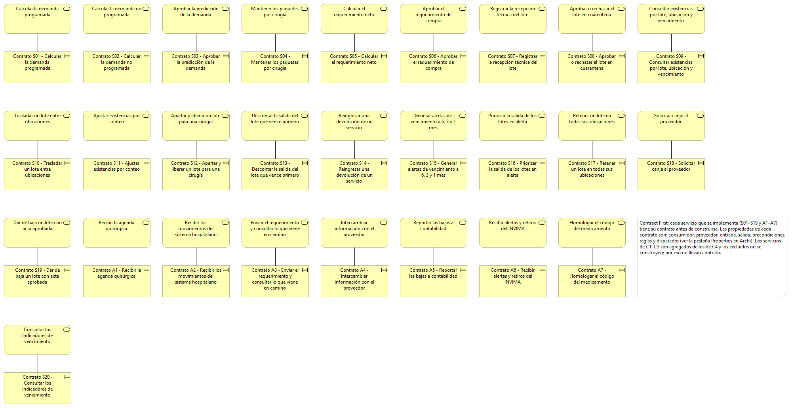

**Qué muestra.** Un **contrato** (objeto `Contract`) asociado a cada servicio que se implementa: **27**, S01–S20 y A1–A7. Su contenido está en siete propiedades: consumidor, proveedor, entrada, salida, precondiciones, reglas y disparador.

**Argumentación:**

| Decisión | Por qué |
|---|---|
| Contrato solo de lo que se construye | Contract First aplica a lo que se va a implementar. C1–C3 son agregados de C4; los excluidos y los externos los prestan otros |
| Contenido en **propiedades** | Siempre las mismas 7 claves: se puede revisar que estén completas y consultarlas en el modelo |
| **Asociación** servicio — contrato | Dice "este contrato rige a este servicio"; el acceso diría que el servicio lee o escribe un dato |
| Las **reglas** son las invariantes de la Fase 4 | Por ejemplo, la regla de S13 "nunca sale un lote vencido ni retenido" es la invariante 2 del agregado Lote |

<b>Los 27 contratos (propiedades de cada objeto Contract en el modelo)</b>

| Contrato | Consumidor | Proveedor | Entrada | Salida | Precondiciones | Reglas | Disparador |
|---|---|---|---|---|---|---|---|
| **S01 - Calcular la demanda programada** | S03 Aprobar la predicción (químico farmacéutico) | Gestión de la demanda | Cirugías programadas (A1); paquetes por cirugía | Demanda programada por medicamento y periodo | Agenda recibida; cada tipo de cirugía tiene paquete vigente | Demanda = cirugías programadas × cantidades del paquete. Las cirugías canceladas no cuentan. El sistema recomienda, no decide | Evento Cirugías programadas en la agenda, o cambio de la agenda |
| **S02 - Calcular la demanda no programada** | S03 Aprobar la predicción (químico farmacéutico) | Gestión de la demanda | Consumos de urgencias de los últimos 5 años (A2) | Demanda no programada estimada por medicamento y periodo | Histórico de consumos disponible | Promedio del histórico, sin estacionalidad ni censo de camas (simplificación del equipo) | Ciclo periódico de planeación |
| **S03 - Aprobar la predicción de la demanda** | S05 Calcular el requerimiento neto | Gestión de la demanda (químico farmacéutico) | Demanda programada y no programada calculadas | Predicción de la demanda aprobada | Predicción calculada (S01 y S02) | Quien elabora no aprueba. El químico puede ajustar antes de aprobar. Sin predicción aprobada no se calcula el requerimiento | Predicción lista para revisión |
| **S04 - Mantener los paquetes por cirugía** | S01 Calcular la demanda programada | Gestión de la demanda (químico farmacéutico) | Tipo de cirugía, medicamentos y cantidades | Paquete por cirugía vigente | Carga inicial desde el Excel actual | Un paquete vigente por tipo de cirugía; un cambio de protocolo crea una versión nueva del paquete | Cambio de protocolo o de paquete |
| **S05 - Calcular el requerimiento neto** | S06 Aprobar el requerimiento de compra | Gestión de requerimientos de compra | Predicción aprobada; existencias por lote; órdenes en camino (A3); lotes que vencerán antes de usarse | Requerimiento de compra en borrador | Predicción aprobada (S03) | Consumo × tiempo a cubrir − existencias − en camino − lo que vencerá antes de usarse. No pide lo que está en alerta y todavía puede usarse. Consumo = lo dispensado, no lo despachado a las satélites (lenguaje ubicuo, V7) | Evento Existencia bajo el mínimo, o ciclo de compra |
| **S06 - Aprobar el requerimiento de compra** | Compras (vía A3) | Gestión de requerimientos de compra (químico farmacéutico) | Requerimiento en borrador; usuario aprobador | Requerimiento de compra aprobado, enviado por A3 | Existe un requerimiento en borrador | Quien elabora no aprueba; una sola regla de aprobación. Farmacia dice qué y cuánto; no se emite orden de compra | Requerimiento en borrador listo |
| **S07 - Registrar la recepción técnica del lote** | S08 Aprobar o rechazar el lote | Control de existencias por lote (regente de farmacia) | Medicamento (código del empaque vía A7); lote; vencimiento; cantidad; ubicación; remisión (A4) | Lote en cuarentena y acta de recepción técnica | El medicamento existe en el catálogo | Lote y vencimiento son obligatorios aunque el código de barras no los traiga. Todo lote nuevo entra en cuarentena | Llegada de un pedido del proveedor |
| **S08 - Aprobar o rechazar el lote en cuarentena** | Servicios de inventario (S09 a S13) | Control de existencias por lote (regente de farmacia) | Lote en cuarentena; resultado de la inspección | Lote disponible, o retenido si se rechaza | El lote está en cuarentena | Nada sale sin recepción técnica. Quien registra la recepción (S07) no la aprueba. Un lote rechazado pasa a retenido con motivo 'rechazado en recepción'; la devolución al proveedor la gestiona compras | Inspección terminada |
| **S09 - Consultar existencias por lote, ubicación y vencimiento** | Químico farmacéutico, regente de farmacia, Enfermería | Control de existencias por lote | Filtros: medicamento, lote, ubicación | Existencias por lote, ubicación, vencimiento y estado, con sus alertas vigentes | Ninguna | Solo lectura. Próximo a vencer se muestra como alerta, no como estado | Consulta del usuario |
| **S10 - Trasladar un lote entre ubicaciones** | Ubicación de destino (servicio o satélite) | Control de existencias por lote (regente de farmacia) | Lote; cantidad; ubicación de origen y de destino | Movimiento de traslado confirmado | Lote disponible con existencia en el origen | Quien recibe confirma. Las existencias nunca quedan negativas. No se trasladan lotes retenidos ni vencidos | Acción ante una alerta, o reposición de una ubicación |
| **S11 - Ajustar existencias por conteo** | Servicios de inventario | Control de existencias por lote | Lote; ubicación; cantidad contada; motivo | Movimiento de ajuste aprobado | Conteo físico registrado | El regente propone y el químico aprueba; quien propone no aprueba. Queda registrado el motivo | Conteo físico con diferencia |
| **S12 - Apartar y liberar un lote para una cirugía** | Cirugía programada | Control de existencias por lote (regente de farmacia) | Lote; cantidad; cirugía programada (A1) | Lote apartado o liberado | Lote disponible; la cirugía está programada | Un lote apartado solo sale para la cirugía para la que se apartó (S13). Se libera si la cirugía se cancela. Se prefiere apartar lotes en alerta | Cirugía programada o cancelada (A1) |
| **S13 - Descontar la salida del lote que vence primero** | Inventario; resultado 100 % de las salidas con lote | Control de existencias por lote (automático) | Salida dispensada: código externo, cantidad, ubicación, fecha y, si aplica, la cirugía (A2) | Movimiento de salida con lote | Hay existencia disponible en la ubicación | Sale el lote que vence primero. Nunca sale un lote vencido, retenido o en cuarentena. Un lote apartado solo sale para la cirugía para la que se apartó (S12). Las existencias nunca quedan negativas | Movimiento recibido del sistema hospitalario |
| **S14 - Reingresar una devolución de un servicio** | Servicios de inventario | Control de existencias por lote (regente de farmacia) | Devolución del servicio: medicamento, lote, cantidad y ubicación (A2) | Movimiento de devolución; lote disponible, vencido o retenido según su condición | Existe la salida original | Una devolución de un servicio no es una devolución al proveedor. Vuelve al mismo lote. Si el lote está vencido vuelve como vencido; si llega deteriorado se retiene (S17) para decidir la baja (S19) | Devolución registrada en el sistema hospitalario |
| **S15 - Generar alertas de vencimiento a 6, 3 y 1 mes** | S16 Priorizar la salida; S18 Solicitar canje | Control de la vida útil de los lotes (automático) | Fecha de corte; lotes disponibles y apartados | Alertas de vencimiento a 6, 3 y 1 mes; lotes que llegaron a su fecha marcados como vencidos | Ninguna | Alertas fijas a 6, 3 y 1 mes. La alerta no cambia el estado: el lote sigue disponible con prioridad de salida. El día que llega su fecha de vencimiento el lote pasa a vencido y queda bloqueado para salir | Corte diario |
| **S16 - Priorizar la salida de los lotes en alerta** | Distribución, dispensación y compras | Control de la vida útil de los lotes (químico farmacéutico) | Alertas vigentes; demanda próxima | Lotes priorizados y acción elegida: trasladar, apartar, frenar la compra o pedir canje | Hay una alerta vigente | Sale primero lo que vence primero. El sistema recomienda y el químico decide | Evento Lote entra en alerta de vencimiento |
| **S17 - Retener un lote en todas sus ubicaciones** | Servicios de inventario (bloquea las salidas) | Control de la vida útil de los lotes (regente retiene, químico confirma) | Lote y motivo: retiro del INVIMA (A6), falla de la cadena de frío, rechazo en recepción (S08) o deterioro en una devolución (S14) | Lote retenido en todas sus ubicaciones | El lote existe | Nunca sale un lote retenido. Solo se retiene; el rastreo de pacientes lo hace farmacovigilancia | Evento Retiro de lote por el INVIMA |
| **S18 - Solicitar canje al proveedor** | Proveedor (vía A4) | Control de la vida útil de los lotes (químico farmacéutico) | Lote con alerta de 6 meses; proveedor | Solicitud de canje enviada por A4 | Alerta de 6 meses vigente | Solo se registra la solicitud; la negociación y la nota crédito las hacen compras y contabilidad | Alerta de 6 meses |
| **S19 - Dar de baja un lote con acta aprobada** | Contabilidad (vía A5) | Control de la vida útil de los lotes (regente elabora, químico aprueba) | Lote vencido o deteriorado; acta de baja | Lote dado de baja; aviso a contabilidad por A5 | El lote está vencido o retenido | Nada se da de baja sin acta aprobada. Quien elabora el acta no la aprueba | Lote vencido, o decisión tras una retención |
| **S20 - Consultar los indicadores de vencimiento** | Químico farmacéutico; gerencia y dirección financiera | Control de la vida útil de los lotes (automático) | Movimientos de inventario con lote; alertas de vencimiento; bajas aprobadas (actas) | % de salidas con lote; % de lo alertado usado antes de vencer; valor dado de baja por vencimiento en el periodo | Ninguna | Solo lectura. Las fórmulas siguen los resultados de la V1. El % de vencidos sobre compras lo calcula financiera con este valor y el valor de compras del periodo | Consulta del usuario o cierre mensual |
| **A1 - Recibir la agenda quirúrgica** | S01, S12 | Capa anticorrupción (C5) | Agenda quirúrgica (E1): cirugías programadas, canceladas y reprogramadas con código de procedimiento y fecha | Cirugías programadas en el lenguaje de farmacia, con su paquete | Tabla procedimiento → paquete cargada | Traduce el procedimiento al paquete por cirugía. Una cancelación libera lo apartado (S12). No modifica la agenda | Publicación o cambio de la agenda |
| **A2 - Recibir los movimientos del sistema hospitalario** | S02, S13, S14 | Capa anticorrupción (C5) | Salidas dispensadas, devoluciones y consumos de urgencias con código externo (E2) | Movimientos de inventario con código interno | Códigos homologados (A7) | El sistema hospitalario no se modifica: se leen sus reportes o el paso nocturno. Un movimiento sin homologación se rechaza y se avisa | Paso nocturno o reporte del sistema hospitalario |
| **A3 - Enviar el requerimiento y consultar lo que viene en camino** | S05, S06 | Capa anticorrupción (C5) | Requerimiento aprobado (S06); órdenes en camino de compras (E3) | Requerimiento en el formato de compras; cantidades en camino por medicamento | Requerimiento aprobado, para el envío | Farmacia dice qué y cuánto; compras dice a quién y a qué precio. No se emiten órdenes de compra | Requerimiento aprobado, o cálculo del requerimiento neto |
| **A4 - Intercambiar información con el proveedor** | S07, S18 | Capa anticorrupción (C5) | Remisión del proveedor con lote y vencimiento (E4); solicitud de canje (S18) | Datos de recepción del lote; solicitud enviada al proveedor | Pedido esperado, o alerta de 6 meses | Lote y vencimiento son obligatorios en la recepción. Del canje solo se envía la solicitud | Llegada del pedido, o solicitud de canje |
| **A5 - Reportar las bajas a contabilidad** | S19 | Capa anticorrupción (C5) | Baja aprobada: acta, lote y valor (S19) | Reporte de baja para el sistema contable (E5) | Acta de baja aprobada | No se reporta una baja sin acta aprobada. El sistema contable no se modifica | Baja aprobada |
| **A6 - Recibir alertas y retiros del INVIMA** | S17 | Capa anticorrupción (C5) | Alerta sanitaria o lote retirado publicado por el INVIMA (E6) | Orden de retener el lote (S17) | Ninguna | El canal puede ser manual: el químico consulta la página del INVIMA y registra la alerta | Publicación del INVIMA |
| **A7 - Homologar el código del medicamento** | A1 a A6, S07, S10 | Capa anticorrupción (C5) | Código externo o código del empaque (E7) y sistema de origen | Código interno del medicamento | Tabla de homologación cargada | Si no hay equivalencia se rechaza y se avisa; nunca se inventa un código | Cada mensaje que entra o sale de la capa anticorrupción |

---

## 5. Dominios y lenguaje ubicuo

### V5 - Dominios

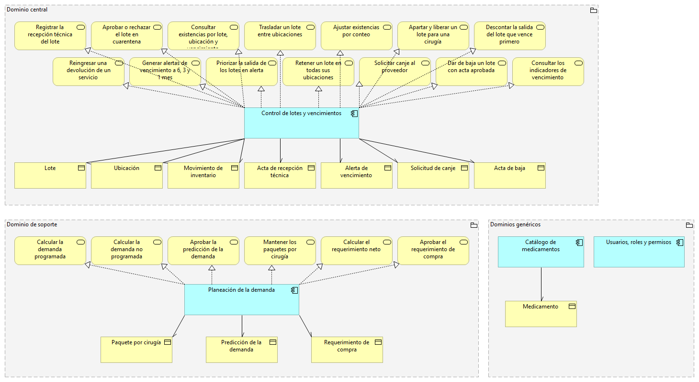

**Qué muestra.** Cada dominio es un **componente de aplicación**, clasificado por una agrupación (y por la propiedad `tipo_dominio`). El componente **realiza** sus servicios de tarea y **es dueño de** sus objetos de negocio.

| Dominio | Tipo | Servicios | Es dueño de | Argumento |
|---|---|---|---|---|
| **Control de lotes y vencimientos** | **Central** | S07–S20 | Lote, Ubicación, Movimiento de inventario, Acta de recepción técnica, Alerta de vencimiento, Solicitud de canje, Acta de baja | Ataca la **causa raíz** ($310 M al año); según el experto, todo lo demás depende de saber qué lote hay. El sistema hospitalario dispensa sin lote y no se puede modificar. Es el **único dueño del agregado Lote**, así que sus invariantes viven en un solo dominio |
| **Planeación de la demanda** | **Soporte** | S01–S06 | Paquete por cirugía, Predicción de la demanda, Requerimiento de compra | Es **específico** del hospital (paquetes por cirugía, requerimiento que descuenta lo que vencerá), por eso no es genérico; pero **lo simplificamos a propósito**, por eso no es central. Depende del central para saber qué se va a vencer |
| **Catálogo de medicamentos** | **Genérico** | — | Medicamento | Un maestro de medicamentos con código interno es un problema resuelto en cualquier inventario |
| **Usuarios, roles y permisos** | **Genérico** | — | — | Mecanismo estándar; soporta la regla "quien registra no aprueba" |

**Argumentación adicional:**
- **La recepción técnica va en el dominio central** porque crea el lote y lo deja en cuarentena: "nada sale sin recepción aprobada" es una invariante del Lote.
- **Dominio = componente de aplicación**, porque el enunciado pide modelar los dominios en la capa de aplicación y porque así cada dominio puede realizar servicios y relacionarse con los demás en el mapa de contextos.

### V7 - Lenguaje ubicuo

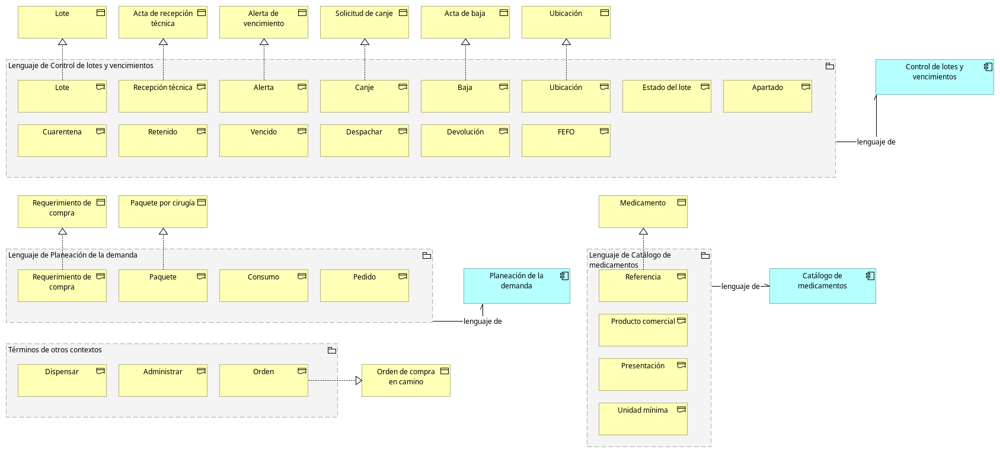

**Qué muestra.** El glosario del proyecto: **25 términos**, cada uno como **representación** (el elemento que recomienda el enunciado), con su definición, ejemplo y dominio. Están agrupados en el lenguaje de cada dominio y en "términos de otros contextos" (dispensar, administrar, orden). Cada término que nombra un objeto de negocio **realiza** ese objeto.

**Argumentación.**
- El experto pidió distinguir siempre **dispensar, despachar y administrar** y **requerimiento de compra y orden de compra**. Por eso hay términos de otros contextos y términos que **no se usan** ("pedido").
- La definición vive en la documentación de cada término, dentro del modelo. Los mismos términos se usan en los nombres de servicios, objetos, agregados, comandos y eventos, y el canvas (V11) reutiliza los 14 del dominio central.

<b>Glosario completo: 25 términos (documentación de cada representación en el modelo)</b>

| Término | Dominio | Definición y ejemplo |
|---|---|---|
| **Alerta** | Control de lotes y vencimientos | En nuestro modelo: aviso de que un lote vence en 6, 3 o 1 mes. No es un estado: el lote sigue disponible y gana prioridad de salida. Ejemplo: alerta a 6 meses para gestionar el canje. Otros significados en V7.1 (alerta sanitaria del INVIMA). |
| **Apartado** | Control de lotes y vencimientos | Estado de las unidades de un lote separadas físicamente para una cirugía; solo salen para esa cirugía y se liberan si se cancela. Se dice 'apartado' y no 'reservado' porque en cirugía 'reserva' es el quirófano o la cama (ver V7.1). Ejemplo: 10 viales apartados para la cirugía del martes. |
| **Baja** | Control de lotes y vencimientos | Retiro definitivo de un lote del inventario por vencimiento, avería o desperdicio, con acta aprobada; quien elabora el acta no la aprueba. No es cualquier descargue. Ejemplo: baja de 20 ampollas vencidas con acta. Otros significados en V7.1 (registro contable del gasto). |
| **Canje** | Control de lotes y vencimientos | Cambio con el proveedor de un lote próximo a vencer por el mismo producto con vencimiento más largo. Farmacia hace la solicitud técnica; compras negocia. No es la devolución al proveedor, que es contra nota crédito. Ejemplo: canje pedido con 6 meses de anticipación. |
| **Cuarentena** | Control de lotes y vencimientos | Estado de un lote recibido que todavía no se puede usar porque espera la aprobación de la recepción técnica. Ejemplo: lote recibido hoy, pendiente de revisión. |
| **Despachar** | Control de lotes y vencimientos | Mover medicamento de la central a una satélite o a un stock de piso, sin paciente asociado. No es consumo: sigue siendo inventario del hospital. Sinónimo: distribuir. No es dispensar ni administrar. Ejemplo: reposición del stock de piso de cirugía. |
| **Devolución** | Control de lotes y vencimientos | En nuestro modelo: el servicio devuelve a la farmacia unidades dispensadas y no administradas; reingresan a su mismo lote si el empaque está íntegro, o quedan retenidas si llegan deterioradas. Ejemplo: alta del paciente con 3 ampollas sin usar. Otros significados en V7.1 (al proveedor, nota crédito). |
| **Estado del lote** | Control de lotes y vencimientos | Situación de las existencias de un lote en una ubicación: cuarentena, disponible, apartado, retenido, vencido o dado de baja. 'Próximo a vencer' no es un estado: es una alerta y el lote sigue disponible con prioridad de salida. Un lote puede tener unidades en distintos estados según la ubicación; vencido y retirado por el INVIMA aplican al lote completo. Ejemplo: 40 ampollas disponibles en la central y 10 apartadas en cirugía. |
| **FEFO** | Control de lotes y vencimientos | Primero en vencer, primero en salir: la salida se descuenta del lote que vence primero. Ejemplo: de dos lotes disponibles sale el que vence en marzo antes que el de junio. |
| **Lote** | Control de lotes y vencimientos | Unidades fabricadas en una misma tanda, con el mismo número y la misma fecha de vencimiento, asignados por el fabricante. Es la unidad de control de la aplicación. Ejemplo: ceftriaxona 1 g, lote A2345, vence 03/2027. Otro significado: en compras, grupo de ítems de una licitación (ver V7.1). |
| **Recepción técnica** | Control de lotes y vencimientos | Revisión de lote, vencimiento, registro sanitario, estado y temperatura de lo recibido; deja el lote en cuarentena hasta aprobarlo, y quien la registra no la aprueba. No es la recepción administrativa, que compara contra orden y factura y la hace almacén. Ejemplo: un regente registra el lote y otro lo aprueba. |
| **Retenido** | Control de lotes y vencimientos | Estado de un lote bloqueado por alerta sanitaria, sospecha de calidad, falla de nevera, rechazo en la recepción o deterioro en una devolución. No sale hasta que un químico lo libera con soporte. Ejemplo: lote retenido en todas sus ubicaciones por un retiro del INVIMA. |
| **Ubicación** | Control de lotes y vencimientos | Lugar físico con existencias: farmacia central (bodega principal), satélite (farmacia pequeña dentro de un servicio), stock de piso (cantidad fija a cargo de enfermería) o carro de paro. Se trata como una sola farmacia con varias ubicaciones. |
| **Vencido** | Control de lotes y vencimientos | Estado de un lote que pasó su fecha de vencimiento; aplica al lote completo, esté donde esté, y nunca sale. Ejemplo: lote con fecha 30/09/2026 el 1/10/2026. Otro significado: factura vencida en contabilidad (ver V7.1). |
| **Consumo** | Planeación de la demanda | En nuestro modelo: lo dispensado, es decir, lo que salió con lote hacia un paciente. No es lo despachado a las satélites, que hoy infla la cifra. Con esta cifra se calcula el requerimiento (S05). Decisión del equipo del 2026-10-12. Otros significados en V7.1. |
| **Paquete** | Planeación de la demanda | Medicamentos y cantidades estándar que se alistan para un tipo de cirugía (unos 180 paquetes). Sinónimo: canasta. Otro significado: en facturación, tarifa integral pactada con el asegurador (fuera del alcance). |
| **Pedido** | Planeación de la demanda | Término que NO se usa en el modelo por ambiguo: se dice requerimiento de compra (de farmacia a compras), orden de compra (de compras al proveedor) o despacho (de la central a una satélite). Es una de las tres confusiones que más problemas causan. Significados en V7.1. |
| **Requerimiento de compra** | Planeación de la demanda | Lo que farmacia necesita comprar: qué y cuánto, aprobado por el químico farmacéutico. No es la orden de compra, que la emite compras al proveedor. Ejemplo: requerimiento ordinario mensual. |
| **Presentación** | Catálogo de medicamentos | Cómo viene empacado el producto. Ejemplo: caja por 1 vial o caja por 50. Ojo: algunos le dicen también presentación a la forma farmacéutica (tableta, ampolla, jarabe); en el modelo es solo el empaque. |
| **Producto comercial** | Catálogo de medicamentos | Una referencia fabricada por un laboratorio concreto, con su registro sanitario y su CUM. Una misma referencia puede tener varios productos comerciales; el CUM es uno de los códigos externos que se homologan al código interno (A7). Ejemplo: ceftriaxona 1 g del laboratorio X, con su registro INVIMA. |
| **Referencia** | Catálogo de medicamentos | Principio activo más concentración y forma farmacéutica; es lo que tiene código interno (unas 1.150). No es el producto comercial (de un laboratorio, con registro sanitario y CUM) ni la presentación (el empaque). Ejemplo: ceftriaxona 1 g polvo para inyección. |
| **Unidad mínima** | Catálogo de medicamentos | El vial, la ampolla o la tableta. Es la unidad en la que se cuentan las existencias de cada lote. Ejemplo: una caja por 50 ampollas son 50 unidades mínimas. |
| **Administrar** | Otro contexto: enfermería | Aplicarle o darle el medicamento al paciente. Lo hace enfermería o anestesiología y queda en la historia clínica; no es de farmacia. La diferencia entre lo dispensado y lo administrado es la devolución. |
| **Dispensar** | Otro contexto: sistema hospitalario | Entregar el medicamento contra una prescripción, a un paciente identificado, con verificación de quien entrega. Es un acto de farmacia que se registra en el sistema hospitalario; nuestro software recibe la salida y la descuenta del lote. No es despachar ni administrar. |
| **Orden** | Otro contexto: compras | En nuestro modelo: orden de compra, que emite compras al proveedor. En el sistema hospitalario, 'orden' es la orden médica (ver V7.1). |

### V7.1 - Términos con varios significados

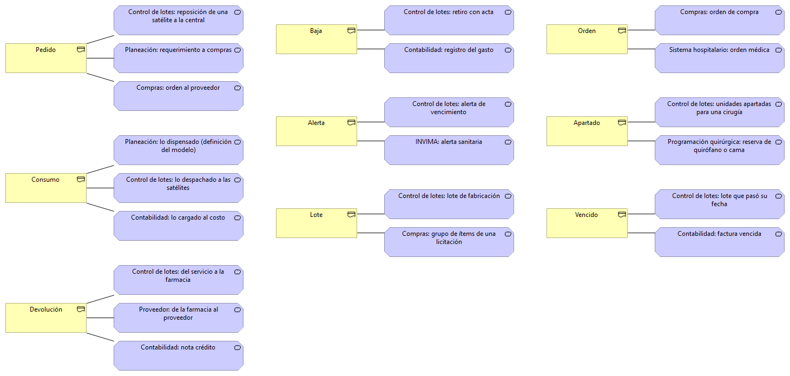

**Qué muestra.** Los 9 términos que cambian de sentido según el contexto, cada uno asociado a sus **significados** (elemento *Meaning*, con las propiedades `termino` y `contexto`).

| Término | Contexto | Significado |
|---|---|---|
| **Alerta** | Control de lotes y vencimientos | Aviso a 6, 3 o 1 mes del vencimiento; el lote sigue disponible con prioridad de salida. Es el significado del modelo. |
| **Alerta** | Alertas sanitarias y retiros de lotes (E6) | Alerta o retiro de un lote publicado por el INVIMA; el lote se retiene en todas sus ubicaciones. |
| **Apartado** | Control de lotes y vencimientos | Unidades de un lote separadas para una cirugía; solo salen para ella. Es el significado del modelo. |
| **Apartado** | Programación quirúrgica (E1) | En cirugía, 'reserva' es el quirófano o la cama de UCI separada. Por eso el modelo dice 'apartado' y no 'reservado'. |
| **Baja** | Registro contable (E5) | Registro del gasto de lo dado de baja, a veces semanas después del acta. |
| **Baja** | Control de lotes y vencimientos | Retiro definitivo del lote por vencimiento, avería o desperdicio, con acta aprobada. Es el significado del modelo. |
| **Consumo** | Registro contable (E5) | Consumo por centro de costo en el sistema contable. |
| **Consumo** | Control de lotes y vencimientos | Lo que hoy la central llama consumo: las salidas hacia las satélites. Infla la cifra porque incluye lo que se queda quieto o se devuelve. En el modelo no es consumo sino despacho. |
| **Consumo** | Planeación de la demanda | Lo que salió con lote hacia un paciente. Es la cifra con la que se calcula el requerimiento (S05). Decisión del equipo del 2026-10-12. |
| **Devolución** | Registro contable (E5) | Registro contable del valor que reconoce el proveedor por lo devuelto. |
| **Devolución** | Control de lotes y vencimientos | Lo dispensado y no administrado que vuelve a la farmacia; reingresa a su mismo lote. Es el significado del modelo. |
| **Devolución** | Suministro de medicamentos (E4) | Lo que sale de la farmacia hacia el proveedor contra nota crédito. No es canje. |
| **Lote** | Gestión de compras (E3) | Para compras, un lote es un grupo de ítems que se licitan juntos. |
| **Lote** | Control de lotes y vencimientos | Unidades de una misma tanda con el mismo número y fecha de vencimiento. Es el significado del modelo. |
| **Orden** | Gestión de compras (E3) | Documento que compras emite al proveedor. Es el significado del modelo. |
| **Orden** | Registro de dispensación y consumos (E2) | Prescripción del médico en hospitalización. |
| **Pedido** | Gestión de compras (E3) | Para compras, el pedido es la orden de compra al proveedor. Es la confusión que más problemas causa: farmacia cree que ya pidió y compras todavía no ha emitido la orden. |
| **Pedido** | Control de lotes y vencimientos | Lo que una satélite le pide a la central. En el modelo se dice despacho o reposición, no pedido. |
| **Pedido** | Planeación de la demanda | Lo que farmacia le pide a compras. En el modelo se dice requerimiento de compra, no pedido. |
| **Vencido** | Registro contable (E5) | Factura que pasó su plazo de pago (cartera y contabilidad). |
| **Vencido** | Control de lotes y vencimientos | Lote que pasó su fecha de vencimiento; nunca sale. Es el significado del modelo. |

**Argumentación.**
- El enunciado pide que un término con significados distintos en dos contextos quede explícito.
- El experto señaló **consumo**, **pedido** y **devolución** como las tres confusiones que más problemas causan. La decisión más importante es **consumo = lo dispensado** (con lote, a un paciente) y no lo despachado a las satélites, que infla la cifra con la que hoy se compra.

---

## 6. Agregados, comandos y eventos

**Cómo los modelamos en ArchiMate.**

| Concepto | Elemento |
|---|---|
| Límite del agregado | Agrupación "Agregado X" |
| Raíz, entidad y objeto de valor | Objetos de datos con las especializaciones «Raíz de agregado», «Entidad» y «Objeto de valor» |
| Comandos | Procesos de aplicación, en infinitivo |
| Eventos | Eventos de aplicación, en participio |
| Comando → evento | Relación de disparo |
| Servicio de dominio | Función de aplicación |
| Evento que llega de fuera | Evento de aplicación "… recibido", asociado al evento de negocio de la V3 |

Las invariantes de cada raíz están en su documentación dentro del modelo.

### V6.1 - Agregado Lote (dominio central)

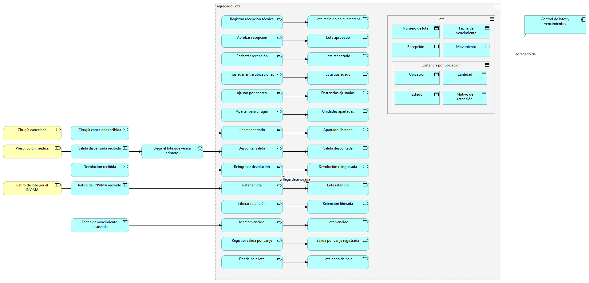

**Raíz *Lote*.** **Identidad:** producto comercial + número de lote (un mismo lote puede llegar en varias entregas).

**Invariantes:**
1. Nada sale sin recepción técnica aprobada, y quien registra la recepción no la aprueba.
2. Nunca sale un lote vencido ni retenido.
3. Las existencias nunca son negativas, y lo recibido cuadra con lo que hay más lo que salió, se devolvió o se dio de baja.
4. Lo apartado solo sale para la cirugía para la que se apartó.
5. Vencido y retenido por el INVIMA aplican al lote completo, en todas sus ubicaciones.
6. Todo movimiento lleva ubicación, responsable y hora.
7. Vida útil mínima al recibir: 12 meses, o el 75 % si es de vida corta.
8. La suma de los lotes de una referencia cuadra cada día con el saldo del sistema hospitalario, que sigue siendo el oficial.

**Dentro de la raíz:**
- **Entidades:** *Recepción*, *Movimiento* y *Existencia por ubicación*.
- **Objetos de valor:** *Número de lote*, *Fecha de vencimiento*, *Ubicación*, *Cantidad*, *Estado* y *Motivo de retención*.
- **Estados del lote:** cuarentena, disponible, apartado, retenido, vencido y dado de baja. *Próximo a vencer* es una alerta y *rechazado* es un motivo de retención; ninguno de los dos es un estado.

**Comandos (14):** registrar, aprobar y rechazar recepción; trasladar; ajustar por conteo; apartar y liberar apartado; descontar salida; reingresar devolución; retener y liberar retención; marcar vencido; registrar salida por canje; dar de baja. Cada uno produce su evento.

**Eventos de entrada:** cirugía cancelada (A1), salida dispensada y devolución (A2), retiro del INVIMA (A6) y fecha de vencimiento alcanzada (tiempo).

**Servicio de dominio FEFO:** *Elegir el lote que vence primero*.

**Argumentación:**

| Decisión | Por qué |
|---|---|
| **Recepción** como entidad dentro del Lote | "Nada sale sin recepción aprobada" es una regla del Lote; para protegerla en una sola transacción tiene que estar dentro de su frontera |
| **Existencia por ubicación** como entidad | Un mismo lote puede estar disponible en la central, apartado en cirugía y retenido en una nevera |
| **FEFO** como servicio de dominio | Compara varios lotes, es decir, varios agregados, para elegir el que vence primero; no pertenece a uno solo |
| Eventos de entrada separados de los de negocio | Distinguen el hecho del negocio (V3) de su llegada al software por la capa anticorrupción |

### V6.2 - Agregados de vencimientos (dominio central)

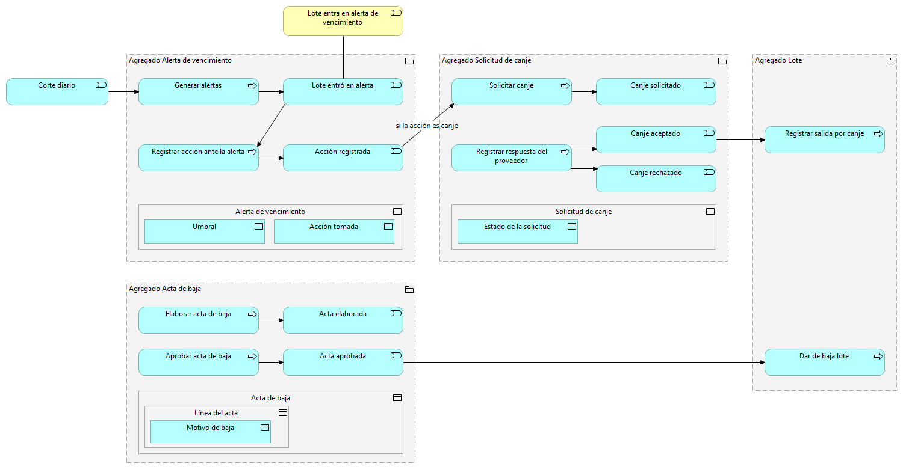

| Agregado (raíz) | Invariantes | Por qué va separado del Lote |
|---|---|---|
| **Alerta de vencimiento** (Umbral, Acción tomada) | Una alerta por lote y umbral; la alerta no cambia el estado del lote; la acción la decide una persona | Se genera en el corte diario y no necesita la misma transacción que las salidas |
| **Solicitud de canje** (Estado de la solicitud) | Solo para un lote en alerta; con la anticipación del proveedor y el empaque cerrado; farmacia solicita y compras negocia; una solicitud respondida no cambia | Tiene ciclo propio: la responde el proveedor |
| **Acta de baja** (Línea del acta, Motivo de baja) | Solo lotes vencidos o retenidos por deterioro; quien elabora no aprueba; un acta aprobada no se modifica; sin acta aprobada no hay baja | Tiene aprobación propia |

**Coordinación por eventos.** Los agregados no se modifican entre sí:
- *Canje aceptado* dispara *Registrar salida por canje* en el Lote.
- *Acta aprobada* dispara *Dar de baja lote*.

Así cada agregado es pequeño y consistente por dentro.

### V6.3 - Planeación de la demanda (dominio de soporte)

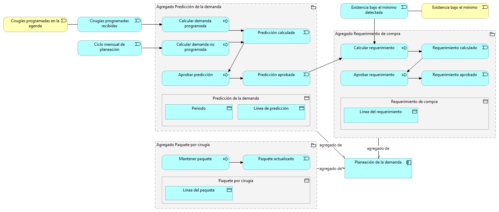

| Agregado (raíz) | Invariantes |
|---|---|
| **Predicción de la demanda** (Periodo, Línea de predicción) | Una sola predicción aprobada por periodo; aprobada, no cambia; demanda = programada (agenda × paquetes) + no programada (promedio del histórico) |
| **Paquete por cirugía** (identidad: tipo de cirugía; Línea del paquete) | Una referencia una sola vez; cantidades mayores que cero; solo referencias del catálogo |
| **Requerimiento de compra** (Línea del requerimiento) | Solo con predicción aprobada; cantidad neta = consumo (lo dispensado) × tiempo − existencias − en camino − lo que vencerá, nunca negativa; quien elabora no aprueba; aprobado, no cambia |

**La cadena:**
1. *Cirugías programadas recibidas* y el *Ciclo mensual* disparan los cálculos de demanda.
2. Se produce *Predicción calculada*, que el químico **aprueba**.
3. *Calcular requerimiento* consulta al dominio central las existencias y lo que vencerá.
4. El requerimiento se **aprueba**.
5. *Existencia bajo el mínimo detectada*, que emite el central, también dispara un nuevo cálculo.

**Toda decisión termina en una persona**, por el principio de la V1.

### V6.4 - Catálogo de medicamentos (dominio genérico)

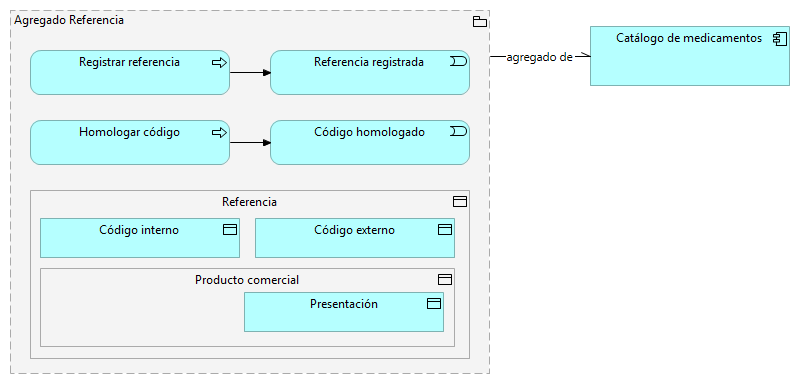

**Raíz *Referencia*:** principio activo + concentración + forma farmacéutica, con código interno. Contiene el *Producto comercial* (entidad: laboratorio, registro sanitario, CUM) y como objetos de valor el *Código interno*, el *Código externo* y la *Presentación*.

**Invariantes:**
1. El código interno es único.
2. Cada código externo apunta a una sola referencia.
3. Toda presentación se convierte a unidad mínima con un factor mayor que cero.

**Comandos:** *Registrar referencia* y *Homologar código*.

*Usuarios, roles y permisos* no tiene diseño táctico: es genérico y se resolvería con una solución estándar de identidad.

---

## 7. Mapa de contextos e interoperabilidad

### V8 - Mapa de contextos

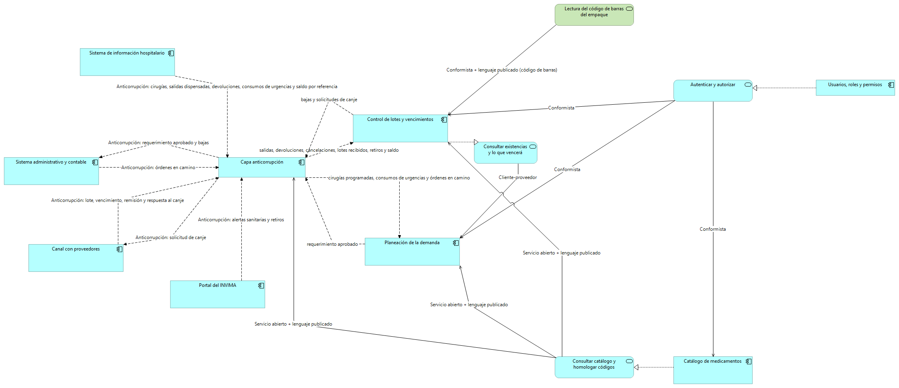

**Qué muestra.** Nuestros 4 contextos, el componente **Capa anticorrupción** y los 4 sistemas externos:
- **Sistema de información hospitalario** (E1, E2; lleva el saldo oficial);
- **Sistema administrativo y contable** (E3, E5);
- **Canal con proveedores** (E4; sin sistema integrado);
- **Portal del INVIMA** (E6).

El patrón de cada relación está en su nombre.

| Relación | Patrón | Upstream (proveedor) | Por qué |
|---|---|---|---|
| Control de lotes → Planeación | **Cliente-proveedor** | Control de lotes, con *Consultar existencias y lo que vencerá* | Planeación necesita existencias y lo que vencerá; el central lo entrega con un servicio acordado |
| Catálogo → todos | **Servicio abierto + lenguaje publicado** | Catálogo, con *Consultar catálogo y homologar códigos* | Muchos lo consumen; publica la referencia con su código interno y la conversión a unidad mínima en un formato común |
| Usuarios → todos | **Conformista** | Usuarios, con *Autenticar y autorizar* | Los contextos usan los roles tal como vienen |
| Código de barras → Control de lotes | **Conformista + lenguaje publicado** | El estándar del código de barras | Es un estándar externo |
| Sistemas externos ↔ nuestros contextos | **Capa anticorrupción** | Los externos, que no se pueden cambiar | Todo lo que entra y sale se traduce para proteger nuestro modelo |

**Coherencia con la capa anticorrupción de la Fase 2:**

| Fase 2 (negocio) | Fase 5 (aplicación) |
|---|---|
| Agrupación C5 | Componente *Capa anticorrupción* (su documentación dice: "reflejo en aplicación de la capa C5") |
| A1–A6 | Servicios de aplicación de la capa, que **realizan** los A1–A6 de negocio (V9) |
| A7 Homologar | *Consultar catálogo y homologar códigos* (servicio abierto del Catálogo), que sirve a la capa |
| E1–E6 | Componentes externos con sus interfaces |

### V9 - Interoperabilidad y anticorrupción

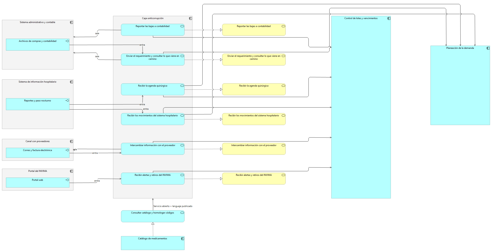

**Qué muestra.** Cómo se implementa cada integración:

| Sistema externo | Interfaz | Servicio de aplicación de la capa | Entrega a |
|---|---|---|---|
| Sistema de información hospitalario | Reportes y paso nocturno | A1 Recibir la agenda quirúrgica · A2 Recibir los movimientos (incluye el saldo por referencia) | Control de lotes y Planeación |
| Sistema administrativo y contable | Archivos de compras y contabilidad | A3 Enviar el requerimiento y consultar lo que viene en camino · A5 Reportar las bajas | Planeación (A3) · Control de lotes (A5) |
| Canal con proveedores | Correo y factura electrónica | A4 Intercambiar información con el proveedor (normaliza fechas) | Control de lotes |
| Portal del INVIMA | Portal web | A6 Recibir alertas y retiros | Control de lotes |

**Argumentación.**
- **Cada servicio de aplicación A realiza el servicio de negocio A de la Fase 2:** es la coherencia entre fases.
- **Las interfaces son reportes, archivos, correos y un portal, no APIs.** Los sistemas no se pueden modificar, los proveedores no tienen sistema integrado y el supuesto 1 del análisis dice que la información se intercambia por reportes, archivos o el paso nocturno.
- **A2 también trae el saldo por referencia**, para cumplir la invariante 8 del Lote: conciliar cada día con el saldo oficial.

### V10 - Trazabilidad vertical

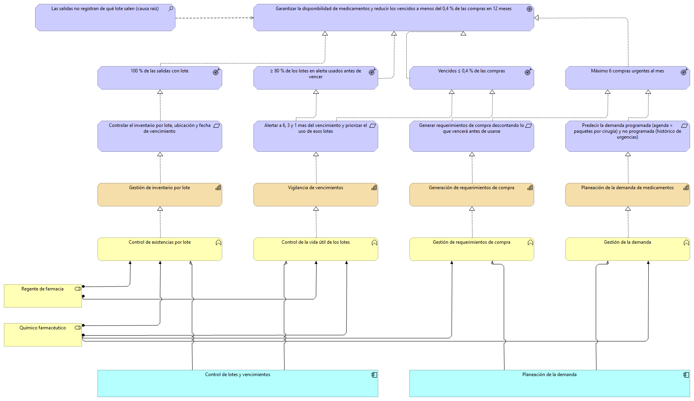

**Qué muestra.** La cadena completa, de la causa raíz al software, en cuatro columnas (una por capacidad impactada):

> **causa raíz** → influye → **meta** ← realiza ← **resultados** ← realiza ← **requerimientos R1–R4** ← realiza ← **capacidades** ← realiza ← **funciones F1–F4** ← sirve a ← **componentes** (Control de lotes sirve a F3 y F4; Planeación sirve a F1 y F2), con los **roles** asignados a las funciones.

**Argumentación.**
- Demuestra que **cada componente de aplicación se traza hasta la meta y la capacidad que lo justifican**, con relaciones horizontales (dentro de una capa) y verticales (entre capas) en Motivación, Estrategia, Negocio y Aplicación.
- El componente **sirve a** la función porque el software apoya (automatiza) el comportamiento del negocio. Además, el componente **realiza** los servicios de tarea de esa función (V5); cada relación *sirve a* documenta cuáles.

---

## 8. Bounded Context Canvas

**Fase 6 · Vista `V11 - Bounded Context Canvas`**

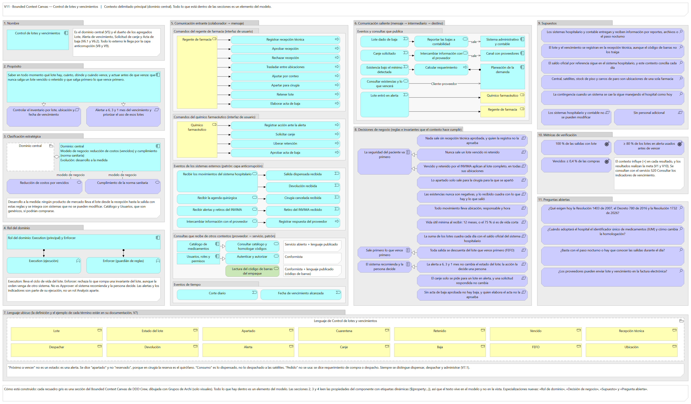

### 8.1 Qué contexto documentamos y por qué

El canvas documenta **Control de lotes y vencimientos**. Es el contexto delimitado principal porque es el dominio central (V5): ataca la causa raíz de la pérdida por vencidos (las salidas no registran de qué lote salen) y es el único dueño del agregado Lote. Planeación de la demanda depende de él (cliente-proveedor, V8), y los dos genéricos, Catálogo y Usuarios, solo le prestan servicios.

### 8.2 Cómo se hizo en Archi (componente investigativo)

Evaluamos tres opciones:

| Opción | Cómo | A favor | En contra | Decisión |
|---|---|---|---|---|
| **A. Vista ArchiMate con grupos como celdas del canvas** | Un *Grupo* visual por sección, ubicado como el canvas de DDD Crew; dentro, elementos del modelo | Coherente con el modelo, reutiliza sin duplicar y todo es ArchiMate | Cuesta que quepa en una página | **Elegida** |
| **B. Canvas propio de Archi** (*File → New → Canvas*) | Bloques de texto e imagen con el diseño exacto de la plantilla | Se ve igual a la plantilla oficial | Sus bloques no son elementos ArchiMate y no se conectan al modelo | Descartada |
| **C. Solo notas en una vista** | Texto con la forma del canvas | Rápido | Es un documento pegado; modelado débil | Descartada |

Cómo se resolvió la opción A:

1. **Se reutilizan los elementos del modelo.** El componente, los requerimientos, los principios, los comandos y eventos de V6.1 y V6.2, los servicios A de la capa anticorrupción, los 14 términos del lenguaje ubicuo y los resultados de V1 son los mismos elementos del modelo, no copias. Si cambia un nombre, cambia también en el canvas.
2. **El canvas lee el modelo con etiquetas dinámicas.** Se agregaron al componente las propiedades `proposito`, `modelo_negocio`, `evolucion` y `rol_dominio` (ya tenía `tipo_dominio`). Las secciones 2, 3 y 4 muestran el mismo componente con una *label expression* (`${property:proposito}`, `${property:modelo_negocio}`…). El texto vive en el modelo y no en la vista.
3. **Especializaciones** para lo que ArchiMate no trae. Son el mecanismo de extensión de ArchiMate 3.2; en Archi se gestionan en *Tools → Specializations Manager*. Las nuevas son «Rol de dominio», «Decisión de negocio», «Supuesto» y «Pregunta abierta». Es el mismo mecanismo que usamos en la Fase 4 para *Raíz de agregado*, *Entidad* y *Objeto de valor*.
4. **Trazabilidad.** Cada elemento nuevo queda relacionado con el componente. En Archi, *Properties → Analysis → Model Relations* del componente muestra todo su canvas.

### 8.3 Sección por sección

| # | Sección | Cómo se modeló | Por qué |
|---|---|---|---|
| 1 | Nombre | Componente *Control de lotes y vencimientos* (V5) | El contexto se implementa como componente, igual que en V8 |
| 2 | Propósito | El componente con la etiqueta `${property:proposito}`, que **realiza** R1 y R2 de V1 | Une el canvas con la motivación; R1 y R2 ya llevan a los resultados y a la meta (V1 y V10) |
| 3 | Clasificación estratégica | *Dominio central* (agregación, V5), el componente con dominio, modelo de negocio y evolución, y dos elementos **Valor** | *Modelo de negocio:* reducción de costos por vencidos y cumplimiento de la norma sanitaria; se modelan como **Valor** porque ArchiMate define el valor como la utilidad que algo aporta. *Evolución:* desarrollo a la medida, porque ningún producto lleva el lote con estas reglas y se integra con sistemas que no se pueden modificar |
| 4 | Rol del dominio | Dos **funciones de aplicación** «Rol de dominio» **asignadas** al componente: *Execution* (principal) y *Enforcer* | La función agrupa comportamiento, que es lo que describe un rol de dominio. No es *Approver*, porque el sistema recomienda y la persona decide. Las alertas y los indicadores son parte de la ejecución, no un rol *Analysis* aparte |
| 5 | Comunicación entrante | Colaborador → mensaje (relación de **disparo**). Comandos del regente y del químico; eventos de los sistemas externos que llegan por A1, A2, A4 y A6 (anticorrupción); consultas a Catálogo (servicio abierto + lenguaje publicado), Usuarios (conformista) y código de barras E7 (conformista + lenguaje publicado); eventos de tiempo | Son los mensajes de V6.1 y V6.2 y los patrones de V8 y V9 |
| 6 | Comunicación saliente | Mensaje → intermediario → destino. *Lote dado de baja* → A5 → contabilidad; *Canje solicitado* → A4 → proveedores; *Existencia bajo el mínimo detectada* → Planeación; *Consultar existencias y lo que vencerá* **sirve a** Planeación (cliente-proveedor, somos el proveedor); *Lote entró en alerta* → químico y regente | Coherente con la capa anticorrupción de V9 y el mapa de V8 |
| 7 | Lenguaje ubicuo | La agrupación *Lenguaje de Control de lotes y vencimientos* con sus 14 términos (V7) y una nota con las precisiones de V7.1 | Definición y ejemplo en la documentación de cada término |
| 8 | Decisiones de negocio | Doce **restricciones** «Decisión de negocio» que el componente **realiza**; las que vienen de un principio de V1 lo **realizan** | Una restricción limita cómo puede comportarse el contexto. Son las 8 invariantes del Lote más las reglas de la alerta, el canje y la baja, y la del FEFO |
| 9 | Supuestos | Cinco **evaluaciones** «Supuesto» más las dos restricciones de partida de V1 | Un supuesto es un juicio sobre la situación que se da por cierto sin haberlo comprobado |
| 10 | Métricas de verificación | Los resultados de V1; el componente los **influye (+)** | Se consultan con el servicio S20 |
| 11 | Preguntas abiertas | Cuatro **evaluaciones** «Pregunta abierta» | Lo que falta confirmar antes de construir |

### 8.4 Decisiones de negocio

1. Nada sale sin recepción técnica aprobada, y quien la registra no la aprueba.
2. Nunca sale un lote vencido ni retenido. *(Principio: la seguridad del paciente va primero.)*
3. Vencido y retenido por el INVIMA aplican al lote completo, en todas sus ubicaciones. *(Principio: la seguridad del paciente va primero.)*
4. Lo apartado solo sale para la cirugía para la que se apartó.
5. Las existencias nunca son negativas, y lo recibido cuadra con lo que hay y lo que salió.
6. Todo movimiento lleva ubicación, responsable y hora.
7. Vida útil mínima al recibir: 12 meses, o el 75 % si es de vida corta.
8. La suma de los lotes cuadra cada día con el saldo oficial del sistema hospitalario.
9. Toda salida se descuenta del lote que vence primero (FEFO). *(Principio: sale primero lo que vence primero.)*
10. La alerta a 6, 3 y 1 mes no cambia el estado del lote; la acción la decide una persona. *(Principio: el sistema recomienda y la persona decide.)*
11. El canje solo se pide para un lote en alerta, y una solicitud respondida no cambia.
12. Sin acta de baja aprobada no hay baja, y quien elabora el acta no la aprueba.

### 8.5 Supuestos y preguntas abiertas

**Supuestos**

- Los sistemas hospitalario y contable entregan y reciben información por reportes, archivos o el paso nocturno.
- El lote y el vencimiento se registran en la recepción técnica, aunque el código de barras no los traiga.
- El saldo oficial por referencia sigue en el sistema hospitalario, y este contexto concilia cada día.
- Central, satélites, stock de piso y carros de paro son ubicaciones de una sola farmacia.
- La contingencia cuando un sistema se cae la sigue manejando el hospital como hoy.

**Preguntas abiertas**

- ¿Qué exigen hoy la Resolución 1403 de 2007, el Decreto 780 de 2016 y la Resolución 1732 de 2026?
- ¿Cuándo adoptará el hospital el identificador único de medicamentos (IUM) y cómo cambia la homologación?
- ¿Basta con el paso nocturno o hay que conocer las salidas durante el día?
- ¿Los proveedores pueden enviar lote y vencimiento en la factura electrónica?

### 8.6 Qué se agregó al modelo en la Fase 6

- **1 vista:** V11.
- **25 elementos nuevos:** 2 roles de dominio, 2 valores, 12 decisiones de negocio, 5 supuestos y 4 preguntas abiertas.
- **57 relaciones nuevas.** Todas se validaron contra las reglas de ArchiMate que trae Archi 5.10.
- **4 especializaciones nuevas.**
- **4 propiedades nuevas en el componente:** `proposito`, `modelo_negocio`, `evolucion` y `rol_dominio`.

No se modificó ni se borró nada de las fases anteriores.

---

## 9. Decisiones y supuestos

**Decisiones de diseño principales**

| # | Decisión | Dónde | Por qué |
|---|---|---|---|
| 1 | Una sola farmacia con varias ubicaciones | Todo el modelo | El lote se controla por ubicación (análisis §3) |
| 2 | La dispensación sigue en el sistema hospitalario; recibimos la salida y la descontamos del lote que vence primero | V4 (S13, X08), V6.1 | El sistema no se puede modificar; ataca la causa raíz |
| 3 | 4 capas de servicio + capa anticorrupción, todas como agrupaciones | V4, V4.2 | Mínimo de cuatro capas; las capas existen en el modelo |
| 4 | 20 servicios de tarea incluidos y 13 excluidos, cada uno justificado | V4 | Alcance preciso |
| 5 | S11 *Ajustar existencias por conteo* incluido aunque no sale del análisis | V4 | Sin él el lote no cuadra con el conteo físico |
| 6 | S20 *Consultar indicadores* incluido | V4 | Solo esta aplicación puede medir los resultados de la V1 |
| 7 | Rol Regente de farmacia y actor Contabilidad creados en la Fase 2 | V4.3, V4.2 | Separación "quien registra no aprueba"; alguien presta el registro contable |
| 8 | E1 lo presta Médicos | V4.2 | El equipo quirúrgico define la agenda |
| 9 | E7 lector de código de barras como dispositivo | V4.2 | Cubre la categoría "dispositivos" del enunciado (supuesto 2) |
| 10 | 27 contratos, solo de lo que se construye | V4.1 | Contract First aplica a lo que se implementa |
| 11 | Dominio central: Control de lotes; soporte: Planeación; genéricos: Catálogo y Usuarios | V5 | Ver la argumentación de la V5 |
| 12 | Consumo = lo dispensado | V7, V7.1, V6.3 | Lo despachado infla la cifra con que se compra |
| 13 | Recepción dentro del agregado Lote; Alerta, Canje y Acta como agregados separados coordinados por eventos | V6.1, V6.2 | Consistencia de las invariantes y transacciones pequeñas |
| 14 | Capa anticorrupción como componente; Catálogo como servicio abierto; Usuarios conformista | V8, V9 | Proteger nuestro modelo de sistemas que no controlamos |
| 15 | Canvas como vista ArchiMate que reutiliza el modelo | V11 | Coherencia con el modelo (ver la sección 8) |

**Supuestos** (análisis §7 y canvas)

1. Los sistemas hospitalario y contable entregan y reciben información por reportes, archivos o el paso nocturno; cómo se hace técnicamente lo define el área de sistemas.
2. El lote y el vencimiento se registran en la recepción técnica, aunque el código de barras no los traiga.
3. Los paquetes por cirugía se cargan una vez desde el Excel actual y los mantiene farmacia.
4. La contingencia cuando el sistema se cae la sigue manejando el hospital como hoy.
5. El saldo oficial por referencia sigue en el sistema hospitalario, y el contexto de lotes concilia cada día.

**Preguntas abiertas**

- ¿Qué exigen hoy la Resolución 1403 de 2007, el Decreto 780 de 2016 y la Resolución 1732 de 2026?
- ¿Cuándo adoptará el hospital el identificador único de medicamentos (IUM)?
- ¿Basta con el paso nocturno o hay que conocer las salidas durante el día?
- ¿Los proveedores pueden enviar lote y vencimiento en la factura electrónica?

---

## 10. Tabla de aportes

Cada aporte se puede verificar en el historial del repositorio. La columna *Commits* enlaza cada commit hasta el 2026-10-15, y el enlace *todos sus commits* filtra el historial de GitHub por autor, así que siempre está al día (incluye también los commits que actualizan esta tabla). El resumen por integrante está en *Insights → Contributors*.

| Integrante | Qué construyó | Commits |
|---|---|---|
| Miguel Moreno ([`mig006`](https://github.com/mig006)) | Estructura del repositorio y rúbrica; Fase 0 (guion, instrucción de rol, entrevista y análisis de hallazgos); Fase 1 (V1–V3); Fase 5 (V8, V9); V10 | [`28e765b`](https://github.com/mig006/Reto_Arquitectura_ArchiMate/commit/28e765b) · [`d52ced5`](https://github.com/mig006/Reto_Arquitectura_ArchiMate/commit/d52ced5) · [`8fb2bc7`](https://github.com/mig006/Reto_Arquitectura_ArchiMate/commit/8fb2bc7) · [`0c8c471`](https://github.com/mig006/Reto_Arquitectura_ArchiMate/commit/0c8c471) · [`59d2e32`](https://github.com/mig006/Reto_Arquitectura_ArchiMate/commit/59d2e32) · [`4c63927`](https://github.com/mig006/Reto_Arquitectura_ArchiMate/commit/4c63927) · [`0f5f6c3`](https://github.com/mig006/Reto_Arquitectura_ArchiMate/commit/0f5f6c3) · [`73a058d`](https://github.com/mig006/Reto_Arquitectura_ArchiMate/commit/73a058d) · [todos sus commits](https://github.com/mig006/Reto_Arquitectura_ArchiMate/commits/main/?author=mig006) |
| Juan Esteban ([`JuanesVasco19`](https://github.com/JuanesVasco19)) | Fase 2 (V4–V4.5: descomposición de servicios, capa anticorrupción y 27 contratos); ajustes visuales de la V8; exportación de las vistas; README principal | [`4e5b31e`](https://github.com/mig006/Reto_Arquitectura_ArchiMate/commit/4e5b31e) · [`edde3e2`](https://github.com/mig006/Reto_Arquitectura_ArchiMate/commit/edde3e2) · [`3e77b93`](https://github.com/mig006/Reto_Arquitectura_ArchiMate/commit/3e77b93) · [`711e423`](https://github.com/mig006/Reto_Arquitectura_ArchiMate/commit/711e423) · [`8f5225b`](https://github.com/mig006/Reto_Arquitectura_ArchiMate/commit/8f5225b) · [`076444e`](https://github.com/mig006/Reto_Arquitectura_ArchiMate/commit/076444e) · [todos sus commits](https://github.com/mig006/Reto_Arquitectura_ArchiMate/commits/main/?author=JuanesVasco19) |
| Abel García ([`abel8000001`](https://github.com/abel8000001)) | Fase 3 (V5, V7, V7.1); Fase 4 en el modelo (V6.1–V6.4); ajustes finales: documentación de los elementos de la Fase 1 en el modelo, verificación de las normas (análisis de hallazgos §6) y tabla de aportes | [`bd74f0b`](https://github.com/mig006/Reto_Arquitectura_ArchiMate/commit/bd74f0b) · [`4b58d0a`](https://github.com/mig006/Reto_Arquitectura_ArchiMate/commit/4b58d0a) · [`92038ef`](https://github.com/mig006/Reto_Arquitectura_ArchiMate/commit/92038ef) · [todos sus commits](https://github.com/mig006/Reto_Arquitectura_ArchiMate/commits/main/?author=abel8000001) |
| Juan José Mesa ([`madvillainnnn`](https://github.com/madvillainnnn)) | Fase 6: Bounded Context Canvas (V11) y su sección del README | [`b440632`](https://github.com/mig006/Reto_Arquitectura_ArchiMate/commit/b440632) · [todos sus commits](https://github.com/mig006/Reto_Arquitectura_ArchiMate/commits/main/?author=madvillainnnn) |
